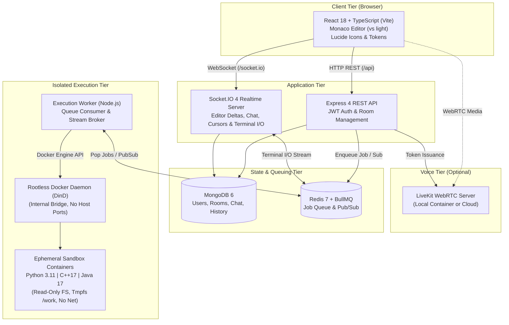

# CodeCollab

CodeCollab is a browser-based collaborative coding platform designed for pair programming, technical interviews, and team code reviews. It provides real-time multi-user document synchronization, interactive in-browser code execution for Python, C++, and Java, integrated room chat, participant presence tracking, and WebRTC voice collaboration—without relying on third-party compiler APIs.

> **Development & Prototype Notice:** CodeCollab is a development prototype intended for trusted local development and team evaluations. The local Docker-in-Docker sandbox on Windows/WSL2 runs with `cgroup driver: none`, which does not enforce kernel-level resource quotas. It is **not qualified for untrusted public execution**. See [Security Boundaries & Known Limitations](#security-boundaries--known-limitations) for details.

---

## Table of Contents

- [Overview & Capabilities](#overview--capabilities)
- [Feature Status](#feature-status)
- [Architecture & Tech Stack](#architecture--tech-stack)
- [Repository Structure](#repository-structure)
- [Prerequisites](#prerequisites)
- [Getting Started](#getting-started)
  - [Option A: Containerized Workflow (Recommended)](#option-a-containerized-workflow-recommended)
  - [Option B: Two-Terminal Local Development](#option-b-two-terminal-local-development)
- [Environment Configuration & Secrets](#environment-configuration--secrets)
- [Application Endpoints](#application-endpoints)
- [Testing & Verification](#testing--verification)
- [Security Boundaries & Known Limitations](#security-boundaries--known-limitations)
- [Contributing & Project Status](#contributing--project-status)

---

## Overview & Capabilities

CodeCollab enables developers to collaborate within shared, authenticated rooms. Key verified capabilities include:

- **User Authentication:** Secure registration and login backed by bcrypt password hashing and signed JWT session tokens.
- **Room Management & Collaboration:** Creation of public or private rooms with 64-bit cryptographic invite tokens, member roster tracking, and Driver/Viewer role designations.
- **Driver-Controlled Editor:** Monaco Editor integration (`vs` light theme) featuring bidirectional code synchronization via Socket.IO, real-time remote cursor tracking, and driver-exclusive edit enforcement with instant driver role transfer.
- **Multi-Language In-House Execution:** Self-contained containerized compilation and execution for Python 3.11, C++17 (GCC 13), and Java 17 (Temurin OpenJDK) without third-party APIs.
- **Interactive Live Terminal:** Direct bidirectional stdin/stdout streaming via Socket.IO. Supports sequential interactive prompts (e.g. `cin`, `Scanner`, `input()`), Unicode input, explicit EOF signaling, execution cancellation, and a strict 10-second overall deadline.
- **Dynamic Java Public-Class Support:** Intelligent detection of top-level public classes, records, enums, or interfaces (`find_java_main_class`), generating the matching `<ClassName>.java` file for standard `javac` compilation while supporting standard `Main` classes.
- **Room Chat & Presence:** Real-time in-room messaging synced across participants and persisted in MongoDB with cursor-paginated chat history.
- **Voice Collaboration:** Low-latency WebRTC group audio powered by LiveKit SDKs when configured.
- **Execution History:** Execution records (source language, status, runtime duration, exit code, and outputs) persisted to MongoDB and queryable per room.
- **Cohesive Light Theme UI:** Clean, unified design tokens (`tokens.css`) with readable contrast across landing page, dashboard, room editor, profile, navbar, and footer.

---

## Feature Status

The table below reflects the actual verified state of the codebase and test suite:

| Feature / Subsystem | Status | Verification & Operational Details |
| :--- | :--- | :--- |
| **User Authentication (JWT + bcrypt)** | Implemented | Verified via unit & API integration suites; registration, login, and `/api/auth/me` profile routes active. |
| **Room Creation & Member Management** | Implemented | Public/private rooms, 64-bit random hex invite codes, invite code rotation, and member authorization active. |
| **Room Deletion Workflow** | **Not Implemented (Deferred)** | Rooms persist in MongoDB; room deletion endpoints and UI controls were deliberately deferred and are not implemented. |
| **Driver / Viewer Role Orchestration** | Implemented | Only the designated Driver can edit code and trigger execution; driver transfer instantly broadcasts to all members. |
| **Monaco Editor Synchronization** | Implemented | Socket.IO delta broadcasts, language synchronization, remote cursor position broadcasts, and driver edit locking. |
| **Python 3.11 Execution** | Implemented | Containerized execution via `codecollab-runner-python:latest` with output capture and timeout enforcement. |
| **C++17 Execution (GCC 13)** | Implemented | In-container compilation (`g++ -std=c++17`) and execution on disposable `/work` tmpfs; interactive input verified. |
| **Java 17 Execution (OpenJDK 17)** | Implemented | In-container compilation (`javac`) and JVM execution; dynamic public class filename matching verified. |
| **Interactive Terminal Stream** | Implemented | Container stdin pipe inheritance; sequential prompt input, explicit EOF, execution stop/cancel, and 10s deadline verified. |
| **Room Chat & Activity Feed** | Implemented | Real-time Socket.IO broadcasts with MongoDB persistence and paginated message retrieval. |
| **Execution History Persistence** | Implemented | Run metadata and execution logs persisted in MongoDB; queryable via `/api/rooms/:roomId/executions`. |
| **Light Theme UI** | Implemented | Centralized design tokens in `tokens.css`, Monaco `vs` light theme, and high-contrast styling across all views. |
| **Voice Collaboration (LiveKit)** | Configuration-Dependent | Implemented in frontend (`VoicePanel.jsx`) and backend token route; requires a running LiveKit server and credentials (`setup.ps1` automates a local dev container). |
| **Kernel Resource Enforcement (cgroups)** | **Known Limitation** | The local rootless DinD profile operates with `cgroup driver: none` on Windows/WSL2; hardware resource bounds are unverified. Classified as `NOT_QUALIFIED_FOR_PRODUCTION`. |
| **Daemon Zombie Reaping** | Resolved | `TINI_SUBREAPER=true` and `pids_limit: 256` in Compose eliminate orphaned helper processes, preventing JVM thread allocation failures (`pthread_create EAGAIN`). |

---

## Architecture & Tech Stack



### Verified Technologies

- **Frontend:** React 18, TypeScript, Vite 8, Monaco Editor (`@monaco-editor/react`), Lucide React, CSS Custom Properties (`frontend/src/styles/tokens.css`).
- **Backend:** Node.js 20+, Express 4, Socket.IO 4, Helmet (hardened HTTP headers), express-rate-limit, CORS, bcryptjs, jsonwebtoken.
- **Database & Object Modeling:** MongoDB 6, Mongoose 8.
- **Asynchronous Queue & Pub/Sub:** Redis 7 (Alpine), BullMQ 6, ioredis 6.
- **Isolated Execution Engine:** Docker 27 rootless daemon (`docker:27-dind-rootless`), standalone Node.js worker, custom runner images based on Debian/Alpine with GNU GCC 13 and Eclipse Temurin OpenJDK 17.
- **Voice Communication:** LiveKit WebRTC (`livekit-client` dynamic import in frontend, `livekit-server-sdk` in backend).

---

## Repository Structure

```text
AWT_2026/
├── backend/                  # Express REST API & authentication services
│   ├── src/
│   │   ├── config/           # Database, client origins, readiness & devBootstrap
│   │   ├── controllers/      # Auth, execution, and room route controllers
│   │   ├── middleware/       # JWT auth, rate limiting, and error handling
│   │   ├── routes/           # Express routers (/api/auth, /api/rooms, /api/execute)
│   │   └── services/         # Room logic, history, voice tokens, interactive sessions
│   └── package.json
├── frontend/                 # React 18 + TypeScript + Vite application
│   ├── src/
│   │   ├── components/       # Monaco Editor, ChatPanel, VoicePanel, Layout (Navbar/Footer)
│   │   ├── context/          # AuthContext, ToastContext
│   │   ├── pages/            # LandingPage, DashboardPage, RoomPage, ProfilePage
│   │   └── styles/           # tokens.css design system
│   ├── vite.config.ts        # Vite configuration with strict proxy to backend
│   └── package.json
├── execution/                # Code execution engine & container runners
│   ├── engine/               # Dockerode wrappers, sandbox config, session protocol
│   ├── runners/              # Python runner.py and C++/Java compiled_runner.py
│   │   ├── cpp/              # C++ runner Dockerfile (GCC 13)
│   │   ├── java/             # Java runner Dockerfile (Temurin OpenJDK 17)
│   │   └── python/           # Python runner Dockerfile (Python 3.11)
│   └── worker/               # BullMQ worker process (index.js, interactive.js)
├── infrastructure/           # Docker Compose services and environment templates
│   ├── docker-compose.yml    # Compose configuration (mongo, redis, backend, frontend, dind, worker)
│   ├── .env.example          # Safe template for infrastructure variables
│   └── docker/               # MongoDB initialization scripts
├── realtime/                 # Socket.IO realtime layer
│   └── server/               # Event handlers for editor sync, driver, chat, and presence
├── scripts/                  # Development and verification helper scripts
│   └── verifyLocalDev.js     # Automated verifier for the two-terminal host dev setup
├── testing/                  # Jest test suites (backend, execution, frontend, realtime, security)
├── docs/                     # Architectural records, API specifications, and security audits
├── setup.ps1                 # Automated prerequisite checker and environment initializer
├── start.ps1                 # Image builder, runner loader, and Compose stack launcher
├── verify.ps1                # Read-only health, container, and runner verification script
├── diagnose.ps1              # Deep diagnostic inspector with recovery steps
└── package.json              # Monorepo root scripts and dependencies
```

---

## Prerequisites

Before setting up CodeCollab, ensure your system meets the following requirements:

- **Operating System:** Windows 10/11 with PowerShell 5.1+ or PowerShell 7+.
- **Docker Desktop:** Installed and actively configured for **Linux containers** with Compose v2 support.
- **Node.js:** `v20.x` or higher (LTS recommended) and `npm` `v10+`.
- **Git:** Installed for repository version control.
- **Port Availability:** Ensure the following ports are free:
  - `3000`: Containerized Frontend
  - `5000`: Containerized Backend API
  - `5001`: Host Development Backend API
  - `5173`: Host Development Frontend (Vite)
  - `6379`: Redis service
  - `27017`: MongoDB service
  - `7880`-`7881`: Local LiveKit development server (voice)

*(Note: If Windows has reserved ports via WinNAT, run `net stop winnat` followed by `net start winnat` in an Administrator PowerShell prompt).*

---

## Getting Started

CodeCollab supports two distinct workflows depending on your objective:

### Option A: Containerized Workflow (Recommended)

This workflow builds and runs the entire stack inside Docker Compose. It is the closest representation of the full integrated architecture.

1. **Run Setup:**
   ```powershell
   .\setup.ps1
   ```
   *What this does:* Validates required tools (Git, Node, Docker), creates `infrastructure/.env` with secure generated secrets (preserving any existing secrets), verifies required ports, starts the local LiveKit voice container (`codecollab-livekit`), and executes `npm ci`.

2. **Build and Start:**
   ```powershell
   .\start.ps1
   ```
   *What this does:* Builds the application images and the three runner images (`codecollab-runner-python`, `codecollab-runner-cpp`, `codecollab-runner-java`), exports and loads the runner images directly into the isolated `execution-daemon`, and starts the Docker Compose stack.

3. **Verify Health:**
   ```powershell
   .\verify.ps1
   ```
   *What this does:* Executes non-destructive checks against all six Compose services, tests HTTP endpoints, and verifies runner image availability inside the isolated daemon.
   - For an end-to-end execution test: `.\verify.ps1 -ExecutionSmoke`
   - For troubleshooting: `.\diagnose.ps1`

4. **Access the Application:**
   - **Frontend UI:** [http://localhost:3000](http://localhost:3000)
   - **Backend API Health:** [http://localhost:5000/health](http://localhost:5000/health)
   - **Backend Readiness:** [http://localhost:5000/ready](http://localhost:5000/ready)

---

### Option B: Two-Terminal Local Development

For active frontend and backend feature work with instantaneous hot reload (Vite HMR and Nodemon), run the application processes directly on your host while keeping state and execution services in Docker.

#### 1. Start Supporting Containers
Ensure Docker Desktop is open and the backing infrastructure services are running:
```powershell
docker compose -f infrastructure/docker-compose.yml --profile local-dev-execution up -d mongo redis execution-daemon execution-worker
```

#### 2. Start Backend (Terminal 1)
```powershell
cd D:\AWT_2026\backend
npm run dev
```
- Runs on **`http://localhost:5001`**.
- Automatically activates `devBootstrap.js`, which reads `infrastructure/.env`, derives the authenticated Redis connection URL (`redis://:***@127.0.0.1:6379/0`), verifies MongoDB/Redis connectivity, and configures CORS origin permissions for Vite.

#### 3. Start Frontend (Terminal 2)
```powershell
cd D:\AWT_2026\frontend
npm run dev
```
- Runs on **`http://localhost:5173`**.
- Vite dev server runs with `strictPort: true` and proxies all `/api`, `/health`, `/ready`, and `/socket.io` requests directly to `http://127.0.0.1:5001`.

#### 4. Automated Local Dev Verification
To verify that both terminals, proxying, and local execution are operational without manual configuration:
```powershell
node scripts/verifyLocalDev.js
```

> **Workflow Port Comparison:**
> - **Full Container Stack:** Frontend on port `3000`, Backend on port `5000`.
> - **Host Dev Stack:** Frontend on port `5173`, Backend on port `5001`.
> Do not mix the ports; the host Vite configuration specifically proxies to port `5001`.

---

## Environment Configuration & Secrets

CodeCollab uses distinct environment configuration layers to isolate development parameters from container orchestration secrets:

| File | Purpose | Managed By |
| :--- | :--- | :--- |
| `infrastructure/.env` | Primary configuration for Docker Compose services (`mongo`, `redis`, `execution-daemon`, `backend`, `frontend`). | Generated/updated safely by `.\setup.ps1` from `.env.example`. |
| `infrastructure/.env.example` | Version-controlled safe template illustrating required environment variables. | Version control (no sensitive values). |
| `backend/.env` or root `.env` | Host-based backend development overrides (`PORT=5001`, `MONGO_URI`, `JWT_SECRET`). | Developer / `devBootstrap.js`. |

### Key Configuration Variables

- **Database (`MongoDB`):**
  - `MONGO_ROOT_USER` & `MONGO_ROOT_PASSWORD`: Administrative credentials for the containerized MongoDB instance.
  - `MONGO_APP_USER` & `MONGO_APP_PASSWORD`: Application-level credentials restricted to the `codecollab` database.
  - `MONGO_HOST_PORT`: Exposed host loopback port (defaults to `27017`).
- **Cache & Queue (`Redis`):**
  - `REDIS_PASSWORD`: Required password for Redis authentication.
  - `REDIS_URL`: Full Redis connection string. Automatically derived by `devBootstrap.js` during host development.
- **Authentication:**
  - `JWT_SECRET`: Cryptographic secret key used to sign and verify user JWTs (minimum 32 characters required).
- **Voice Collaboration (`LiveKit`):**
  - `LIVEKIT_URL`: WebSocket endpoint of the LiveKit server (defaults to `ws://127.0.0.1:7880` in local dev).
  - `LIVEKIT_API_KEY`: API key for server communication (defaults to `devkey`).
  - `LIVEKIT_API_SECRET`: Secret key used **exclusively by the backend** to mint short-lived room tokens (`secret`). Never expose this secret to the client.

> **Security Rule:** Never commit real `.env` or `infrastructure/.env` files to Git. `setup.ps1` generates randomized passwords on initial setup and never overwrites existing credentials.

---

## Application Endpoints

### Service URLs

| Service / Endpoint | Container Stack | Host Dev Stack | Description |
| :--- | :--- | :--- | :--- |
| **Frontend UI** | `http://localhost:3000` | `http://localhost:5173` | Web application interface |
| **Backend Base URL** | `http://localhost:5000` | `http://localhost:5001` | REST API root |
| **Liveness Check** | `GET /health` (Port 5000) | `GET /health` (Port 5001) | Returns HTTP 200 `{ status: "ok" }` if process is active |
| **Readiness Check** | `GET /ready` (Port 5000) | `GET /ready` (Port 5001) | Returns HTTP 200 only if MongoDB and Redis connections are live |
| **Socket.IO Realtime** | `ws://localhost:5000/socket.io/` | `ws://localhost:5001/socket.io/` | Realtime channel (proxied at `ws://localhost:5173/socket.io/`) |

### Primary REST API Routes

- **Authentication (`/api/auth`)**
  - `POST /register`: Register a new user account (rate-limited).
  - `POST /login`: Authenticate credentials and receive JWT (rate-limited).
  - `GET /me`: Fetch authenticated user profile (Bearer token required).
- **Rooms (`/api/rooms`)**
  - `POST /`: Create a new collaboration room.
  - `GET /`: List rooms belonging to authenticated user.
  - `POST /join`: Join a room via `roomId` or private `joinCode`.
  - `GET /:roomId`: Retrieve room details (members only).
  - `POST /:roomId/invite`: Generate or rotate private room invite code (owner only).
  - `GET /:roomId/messages`: Paginated chat history (members only).
  - `GET /:roomId/executions`: Paginated execution history (members only).
  - `POST /:roomId/voice-token`: Mint short-lived LiveKit access token (members only).
- **Execution (`/api/execute`)**
  - `POST /`: Submit code execution job (Driver role and rate-limit enforced).

---

## Testing & Verification

The project includes an extensive automated test suite covering frontend components, backend controllers, realtime Socket.IO handlers, execution sandboxing, and security isolation.

### Available Test Commands

Run tests from the repository root:

```powershell
# Run the core Jest test suite across backend, execution, and realtime
npm test

# Run backend API, authentication, and room tests
npm run test:backend

# Run execution engine, worker, and runner sandbox tests
npm run test:execution

# Run frontend React component, hook, and layout tests
npm run test:frontend

# Run Socket.IO realtime synchronization and driver tests
npm run test:realtime

# Typecheck and build production frontend assets
npm run build

# Run live MongoDB integration tests (requires disposable local MongoDB)
npm run test:integration:mongo

# Evaluate host sandbox cgroup resource enforcement
npm run eval:enforcement
```

### Verified Test Baseline

The current repository passes all unit, integration, and build validations:

- **Frontend Tests (`npm run test:frontend`):** 9 test suites passed, 102 tests passed, 0 failures.
- **Frontend Production Build (`npm run build`):** TypeScript validation and Vite client bundle compiled in 1.00s.
- **Execution Tests (`npm run test:execution`):** 8 test suites passed, 113 tests passed, 0 failures.
- **Backend Tests (`npm run test:backend`):** 8 test suites passed, 99 tests passed, 0 failures.
- **Realtime Tests (`npm run test:realtime`):** 7 test suites passed, 31 tests passed, 0 failures.
- **Total Combined Baseline:** **32 test suites passed, 345 tests passed, 0 failures.**

---

## Security Boundaries & Known Limitations

CodeCollab applies strict defense-in-depth principles across its application and container architecture, but users and operators should be fully aware of current sandbox qualifications.

### 1. Local Rootless Docker-in-Docker Sandbox (Known Limitation)
- In the local Windows/WSL2 development profile, the nested rootless Docker daemon (`execution-daemon`) operates with `cgroup driver: none`.
- While CPU (`--cpus 1.0`), memory (`--memory 512m`), and PID (`--pids-limit 256`) arguments are passed to container commands, the local host kernel cannot enforce hardware CFS throttling or OOM kills without native Linux cgroup v2 delegation.
- The project enforcement evaluation harness (`npm run eval:enforcement`) reports `NOT_QUALIFIED_FOR_PRODUCTION`.
- **Classification:** CodeCollab is a **trusted development prototype**. It must **not** be deployed to public environments for executing arbitrary, untrusted user code until qualified on native Linux with systemd cgroups v2 and `runsc` (gVisor).

### 2. Container Isolation Defenses (Implemented)
Even within the local development setup, disposable runners enforce strict runtime guardrails:
- **Network Isolation:** All language containers run with `--net none` (zero internet or local network access).
- **Filesystem Hardening:** The container root filesystem is mounted strictly read-only (`--read-only`). Writable compilation artifacts are isolated to an ephemeral `/work` tmpfs mount.
- **Privilege Separation:** Containers execute as an unprivileged user (`UID 1000` / `sandbox`). Root execution is explicitly rejected.
- **Capability Dropping:** All Linux capabilities are dropped (`--cap-drop=ALL`), and `no-new-privileges` is enforced.
- **Resource & Timeout Deadlines:** Strict 10-second cumulative deadline covering compilation and execution. Source code is capped at 64 KiB, and I/O streams are truncated at 64 KiB per stream.

### 3. Daemon Zombie Reaping (Resolved)
- Earlier iterations exhibited Java native-thread allocation failures (`pthread_create failed (EAGAIN)` / `OutOfMemoryError: unable to create native thread`) caused by orphaned `containerd-shim` helper processes exhausting the daemon PID limit.
- This has been resolved in `infrastructure/docker-compose.yml` by enabling `init: true`, configuring `TINI_SUBREAPER=true`, raising the outer daemon limit to `pids_limit: 256`, and applying conservative JVM memory limits (`-XX:ActiveProcessorCount=2`, `-XX:CICompilerCount=2`, `-XX:+UseSerialGC`, `-Xms16m`, `-Xmx96m`, `-Xss256k`).

### 4. Room Deletion (Known Limitation)
- Room deletion is deliberately **not implemented**. Rooms created by users persist in MongoDB. There is currently no API endpoint or UI action to delete a room.

---

## Contributing & Project Status

### Development Workflow

1. Fork or clone the repository.
2. Run `.\setup.ps1` to ensure local prerequisites, dependencies, and configuration are set up.
3. Create a feature branch: `git checkout -b feature/your-feature-name`.
4. Implement your changes following established modular patterns.
5. Verify your work by running the full test suite and frontend build:
   ```powershell
   npm test
   npm run test:frontend
   npm run build
   ```
6. Submit a pull request with an explanation of your changes and test coverage evidence.

### License

This project is licensed under the **ISC License** as specified in `package.json`.
